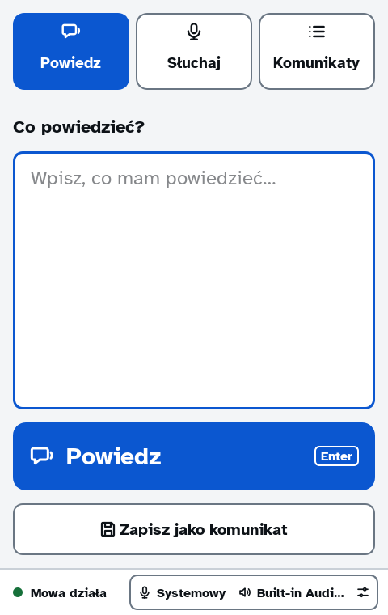
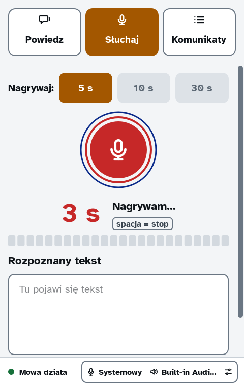
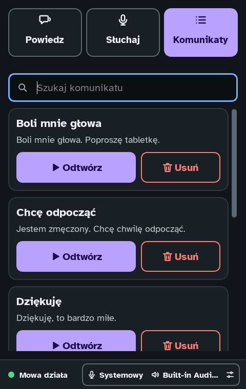
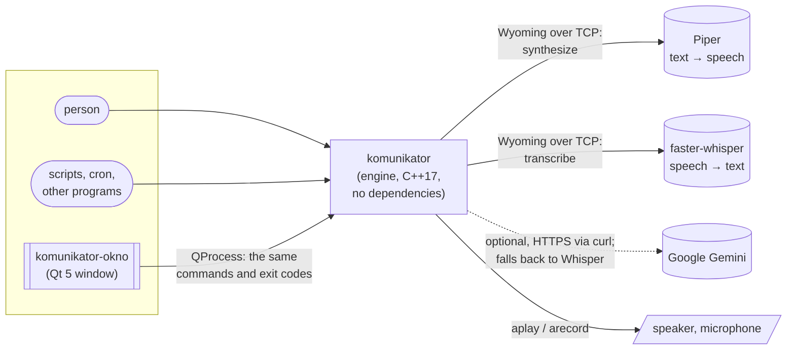

<div align="center">

# komunikator

**Speech for the command line — say it, save it, hear it back, transcribe it.**

A small, dependency-free C++17 tool that turns text into speech and speech into text
over the open [Wyoming](https://github.com/rhasspy/wyoming) protocol, plus a calm Qt desktop window on top.


</div>

<table>
  <tr>
    <td align="center"><br><sub><b>Say</b> — type, press Enter, hear it</sub></td>
    <td align="center"><br><sub><b>Listen</b> — record and transcribe</sub></td>
    <td align="center"><br><sub><b>Messages</b> — ready-made phrases, offline</sub></td>
  </tr>
</table>

---

## Why it exists

`komunikator` (Polish for *communicator*) started as a practical need in a home-automation setup:
a voice that scripts, timers and people can all use the same way — and that keeps working when
the network or a cloud service does not.

It is built around three ideas:

- **One tiny engine, many callers.** Everything is a command with stable exit codes, so a shell
  script, a Python program, a cron job and a human at the keyboard use exactly the same interface.
- **No dependencies at the core.** The engine needs only a C++17 compiler and the standard library.
  It speaks the Wyoming protocol itself (TCP sockets, its own JSON and WAV code), so it talks
  directly to [Piper](https://github.com/rhasspy/piper) (text-to-speech) and
  [faster-whisper](https://github.com/rhasspy/wyoming-faster-whisper) (speech-to-text) — the same
  services Home Assistant uses — without Home Assistant in between.
- **Never leave the user with a raw error.** People see one plain sentence that says what happened
  and what to do. The technical details go to a log file, so nothing is lost for debugging.

## Features

| | |
|---|---|
| 🗣️ **Say** | Speak any text immediately, or render it to a WAV file. Text can come from arguments or `stdin`. |
| 💾 **Saved messages** | Store phrases under a name and play them back later — **even with the speech server down**, because the audio is kept on disk. |
| 🎙️ **Listen** | Record from a chosen microphone and print the transcript; live input levels for UIs (`--poziomy`). |
| 📝 **Transcribe** | Turn any WAV file (or a piped `arecord` stream) into text. |
| ☁️ **Optional cloud** | Transcription through Google Gemini for better accuracy — with automatic, silent fallback to local Whisper when the internet, the key or the service fails. |
| 🎛️ **Explicit devices** | Microphone and speaker are chosen once, like in a desktop app, and remembered. The program **never silently falls back to a "default" device**. |
| 🪟 **Desktop window** | A Qt 5 app with light and dark themes, keyboard-first (Enter, Space, Esc), a tray icon and a single instance. |
| 🔌 **Built for other programs** | Results on `stdout`, diagnostics on `stderr`, documented exit codes, settings overridable by environment variables. |

## Quick start

```bash
git clone https://github.com/mafio69/komunikator.git
cd komunikator
make            # the engine: C++17 + standard library, nothing else
make test       # unit + integration tests (nothing is played aloud)
make install    # copies the binary to ~/.local/bin
```

You need two Wyoming services reachable over TCP, for example as containers:

```bash
docker run -d -p 10200:10200 rhasspy/wyoming-piper   --voice pl_PL-gosia-medium
docker run -d -p 10300:10300 rhasspy/wyoming-whisper --model small --language pl
```

Then:

```bash
komunikator sprawdz                               # are the speech services alive?
komunikator powiedz Dzień dobry                   # say something
komunikator zapisz pies Wyprowadź Dextera         # save a message called "pies"
komunikator odtworz pies                          # play it back — works offline too
komunikator sluchaj 5                             # record 5 s and print what was said
komunikator rozpoznaj nagranie.wav                # transcribe a file
```

> The command names are Polish, because that is the language of the people who use it every day.
> The full manual is in Polish as well: **[INSTRUKCJA.md](INSTRUKCJA.md)** (every command) and
> **[INSTALACJA.md](INSTALACJA.md)** (building, settings, the window, static builds).

The desktop window is a separate program with its own dependencies (Qt 5):

```bash
make okno && make okno-install
```

## Using it from other programs

The engine is designed to be called from code.

| Exit code | Meaning |
|:---:|---|
| `0` | Done |
| `1` | Runtime problem (speech service, file, player) — a human-readable sentence is on `stderr` |
| `2` | Wrong command or arguments, or no microphone/speaker chosen yet |
| `130` | Stopped on purpose (`Ctrl+C` or `SIGTERM`); playback is stopped, a recording keeps what was captured |

```bash
# A doorbell announcement that degrades gracefully:
# speak live, and if the speech server is unreachable, play the pre-recorded message.
komunikator powiedz "Someone is at the door" || komunikator odtworz dzwonek
```

```python
import subprocess

text = subprocess.run(
    ["komunikator", "rozpoznaj", "recording.wav"],
    capture_output=True, text=True, check=True,
).stdout.strip()
```

- `komunikator lista` prints one `NAME<TAB>TEXT` line per saved message.
- Every setting can be overridden per call, e.g. `KOMUNIKATOR_TTS=10.0.0.5:10200 komunikator powiedz …`.
- `KOMUNIKATOR_SZCZEGOLY=1` additionally prints the technical details of an error.

## How it works



The Wyoming protocol is simple and robust: each event is one line of JSON, optionally followed by
raw bytes (audio). The engine implements it directly on POSIX sockets, with timeouts and limits on
every read, so a misbehaving server cannot hang or flood it.

The window never links against the engine. It runs the very same commands through `QProcess`,
which keeps one source of truth for behaviour and messages, and means the window can be replaced
without touching the core.

### Source layout

| Path | Responsibility |
|---|---|
| `src/main.cpp` | Commands, settings, saved messages, device selection, signal handling |
| `src/wyoming.cpp` | Wyoming client: connection, framing, `synthesize`, `transcribe`, `describe` |
| `src/json.cpp` | A strict JSON parser and writer (RFC 8259 numbers, depth limit, UTF-16 surrogates) |
| `src/wav.cpp` | WAV reading and writing (PCM, including `WAVE_FORMAT_EXTENSIBLE`) |
| `src/bledy.cpp` | Human-readable errors (`Blad`) and the diagnostic log |
| `src/gemini.cpp` | Optional cloud transcription; the API key never appears on the command line |
| `okno/` | The Qt 5 desktop window (`silnik.cpp` is the thin layer that talks to the engine) |
| `testy/` | Unit tests in C++ and integration tests in shell |
| `design/` | The visual specification the window is built from |

## Error messages people can live with

A typical tool prints `connect: Connection refused` and leaves you guessing. `komunikator` prints:

```text
komunikator: Nie mogę połączyć się z: usługa mowy (192.168.1.10:10200). Sprawdź, czy serwer jest włączony i czy adres jest dobry: komunikator ustawienia.
```

*(“I can't reach the speech service at … Check that the server is running and the address is right.”)*

Every failure has a kind (`UslugaNiedostepna`, `UslugaNieOdpowiada`, `ZlyDzwiek`, …), a sentence
for humans, and technical details. The details — `errno` text, the server's own error, the position
of a malformed JSON byte — are written to `~/.local/state/komunikator/dziennik.log` (rotated at
1 MB). The tests assert that no technical wording ever reaches the user.

## Quality

The code is held to a simple standard: no warnings, no undefined behaviour, and a test for every
bug that was found.

- **Warning-free** with `-Wall -Wextra -Wpedantic`; `make sprawdz` builds with `-Werror`.
- **Sanitized:** the whole test suite also runs against a build with
  AddressSanitizer and UndefinedBehaviorSanitizer (`-fno-sanitize-recover=all`).
- **23 unit tests** in C++ with a tiny in-repo test harness (no frameworks — the project rule).
  The Wyoming client is tested against a fake server running in a thread: a full synthesis, a bad
  address, a server that is down, one that sends garbage, one that reports an error, and one that
  never answers.
- **35 integration tests** in shell drive the real binary end to end, including the speech services
  when they are available. Nothing is ever played aloud during tests.
- Writing the tests found real bugs, now fixed and guarded: lenient number parsing
  (`"1-2"` was accepted), undefined behaviour when converting huge numbers, and unchecked audio
  parameters from the server.

```bash
make sprawdz    # -Werror + full test suite under ASan/UBSan
```

## Security and privacy

- The Gemini API key is read from `stdin`, stored with `0600` permissions, never printed, and passed
  to `curl` through a temporary header file — so it never shows up in shell history or `ps`.
- Temporary files with audio or keys are owner-only and removed as soon as they are no longer needed.
- Message names are validated against path traversal (`../`, leading dots, control characters).
- The engine runs no shell: helper programs are started with `posix_spawn` and explicit arguments.

## Roadmap

- [ ] Split the two largest files (`src/main.cpp`, `okno/okno.cpp`) into one module per command and per screen
- [ ] Continuous integration on GitHub Actions: build, tests, sanitizers
- [ ] `clang-format`, `clang-tidy` and `cppcheck` in `make sprawdz`
- [ ] A resident mode with a UNIX-socket API and a speaking queue (draft in `src/demon.*`)
- [ ] An optional bridge to a Home Assistant voice satellite, kept separate from the core

## How it was built

This project is written by **Mariusz** together with **Claude** (Anthropic) as an AI pair programmer.
Mariusz sets the goals, makes the decisions and tests everything on real hardware at home;
Claude writes most of the code under one rule: **no shortcuts** — every change builds without
warnings, passes the tests under sanitizers, and is explained in its commit message.
Every commit made with AI assistance is marked with a `Co-Authored-By: Claude` trailer,
so the history shows exactly who did what.

---

<div align="center">
<sub>Made in Poland for a home where a voice assistant, a dog called Dexter and a lot of music live together.</sub>
</div>
