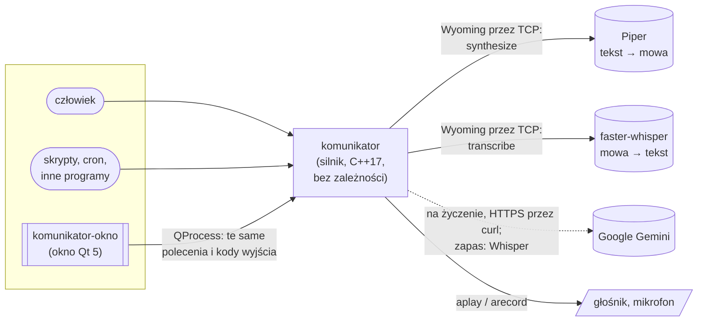

<div align="center">

# komunikator

**Mowa z linii poleceń: powiedz, zapisz, odtwórz, zamień na tekst.**

Mały program w C++17 bez zależności, który zamienia tekst na mowę i mowę na tekst przez otwarty
protokół [Wyoming](https://github.com/rhasspy/wyoming), z prostym, spokojnym oknem w Qt.

*English version: [README.md](README.md)*

</div>

<table>
  <tr>
    <td align="center"><br><sub><b>Powiedz</b>: wpisz, Enter i słychać</sub></td>
    <td align="center"><br><sub><b>Słuchaj</b>: nagraj i zamień na tekst</sub></td>
    <td align="center"><br><sub><b>Komunikaty</b>: gotowe zdania, bez internetu</sub></td>
  </tr>
</table>

---

## Po co powstał

Komunikator wziął się z praktycznej potrzeby w domu z automatyką. Chodziło o głos, którego
skrypty, budziki i ludzie używają tak samo. Taki, który działa dalej, gdy padnie sieć albo usługa
w chmurze.

Stoi na trzech zasadach:

- **Jeden mały silnik, wielu użytkowników.** Wszystko jest poleceniem ze stałymi kodami wyjścia,
  więc skrypt, program w Pythonie, cron i człowiek przy klawiaturze używają dokładnie tego samego.
- **Zero zależności w podstawie.** Silnik potrzebuje tylko kompilatora C++17 i biblioteki
  standardowej. Sam mówi protokołem Wyoming: gniazda TCP, własny kod JSON i WAV. Rozmawia więc
  wprost z [Piperem](https://github.com/rhasspy/piper) (tekst na mowę) i
  [faster-whisperem](https://github.com/rhasspy/wyoming-faster-whisper) (mowa na tekst), tymi
  samymi usługami, których używa Home Assistant, ale bez niego po drodze.
- **Nigdy surowy błąd.** Człowiek dostaje jedno zwykłe zdanie: co się stało i co zrobić.
  Szczegóły techniczne idą do dziennika, więc do diagnozy nic nie ginie.

## Co potrafi

| | |
|---|---|
| 🗣️ **Powiedz** | Wypowiada dowolny tekst od razu albo zapisuje go do pliku WAV. Tekst z argumentów albo ze standardowego wejścia. |
| 💾 **Komunikaty** | Zdania zapisane pod nazwą i odtwarzane później, **także gdy serwer mowy nie działa**, bo dźwięk leży na dysku. |
| 🎙️ **Słuchaj** | Nagrywa z wybranego mikrofonu i wypisuje rozpoznany tekst. Podaje też poziom dźwięku na bieżąco dla okien (`--poziomy`). |
| 📝 **Rozpoznaj** | Zamienia na tekst dowolny plik WAV albo nagranie płynące prosto z `arecord`. |
| ☁️ **Chmura na życzenie** | Rozpoznawanie przez Google Gemini dla lepszej dokładności. Przy braku internetu, klucza albo awarii program sam i po cichu przechodzi na lokalnego Whispera. |
| 🎛️ **Jawne urządzenia** | Mikrofon i głośnik wybiera się raz, jak w aplikacji na pulpit, a program je zapamiętuje. **Nigdy po cichu nie gra na „domyślnym”.** |
| 🪟 **Okno** | Aplikacja w Qt 5: jasny i ciemny motyw, obsługa z klawiatury (Enter, spacja, Esc), ikona w zasobniku, jedna kopia programu. |
| 🔌 **Dla innych programów** | Wynik na `stdout`, diagnostyka na `stderr`, opisane kody wyjścia, ustawienia nadpisywane zmiennymi środowiska. |

## Szybki start

```bash
git clone https://github.com/mafio69/komunikator.git
cd komunikator
make            # silnik: C++17 i biblioteka standardowa, nic więcej
make test       # testy jednostkowe i integracyjne (nic nie mówi na głos)
make install    # kopiuje program do ~/.local/bin
```

Potrzebne są dwie usługi Wyoming dostępne przez TCP, na przykład jako kontenery:

```bash
docker run -d -p 10200:10200 rhasspy/wyoming-piper   --voice pl_PL-gosia-medium
docker run -d -p 10300:10300 rhasspy/wyoming-whisper --model small --language pl
```

A potem:

```bash
komunikator sprawdz                               # czy usługi mowy odpowiadają
komunikator powiedz Dzień dobry                   # powiedz coś
komunikator zapisz pies Wyprowadź Dextera         # zapisz komunikat "pies"
komunikator odtworz pies                          # odtwórz, działa też bez sieci
komunikator sluchaj 5                             # nagraj 5 s i wypisz, co powiedziano
komunikator rozpoznaj nagranie.wav                # zamień plik na tekst
```

Pełna dokumentacja po polsku: **[INSTRUKCJA.md](INSTRUKCJA.md)** (wszystkie polecenia) i
**[INSTALACJA.md](INSTALACJA.md)** (budowanie, ustawienia, okno, wersja statyczna).
Po angielsku: [INSTRUCTIONS.md](INSTRUCTIONS.md) i [INSTALL.md](INSTALL.md).

Okno to osobny program z własnymi zależnościami (Qt 5):

```bash
make okno && make okno-install
```

## Dla innych programów

Silnik jest zrobiony tak, żeby wołać go z kodu.

| Kod wyjścia | Znaczenie |
|:---:|---|
| `0` | Zrobione |
| `1` | Kłopot w trakcie (usługa mowy, plik, odtwarzacz). Na `stderr` jest zdanie po ludzku. |
| `2` | Złe polecenie albo argumenty, albo nie wybrano jeszcze mikrofonu lub głośnika |
| `130` | Zatrzymane na życzenie (`Ctrl+C` albo `SIGTERM`). Odtwarzanie staje, nagranie zachowuje to, co się nagrało. |

```bash
# Dzwonek do drzwi, który działa też w awarii:
# mów na żywo, a gdy serwer mowy nie odpowiada, odtwórz gotowy komunikat.
komunikator powiedz "Ktoś jest przy drzwiach" || komunikator odtworz dzwonek
```

```python
import subprocess

tekst = subprocess.run(
    ["komunikator", "rozpoznaj", "nagranie.wav"],
    capture_output=True, text=True, check=True,
).stdout.strip()
```

- `komunikator lista` wypisuje jedną linię `NAZWA<TAB>TEKST` na komunikat.
- Każde ustawienie można nadpisać dla jednego wywołania, np. `KOMUNIKATOR_TTS=10.0.0.5:10200 komunikator powiedz …`.
- `KOMUNIKATOR_SZCZEGOLY=1` dopisuje do błędu szczegóły techniczne.

## Jak to działa



Protokół Wyoming jest prosty i solidny. Każde zdarzenie to jedna linia JSON, a po niej
opcjonalnie surowe bajty dźwięku. Silnik obsługuje go sam na gniazdach POSIX, z limitem czasu
i rozmiaru przy każdym odczycie, więc źle działający serwer nie może go zawiesić ani zalać danymi.

Okno nie jest zlinkowane z silnikiem. Uruchamia dokładnie te same polecenia przez `QProcess`.
Dzięki temu zachowanie i komunikaty mają jedno źródło, a okno można wymienić bez dotykania silnika.

### Układ kodu

| Ścieżka | Za co odpowiada |
|---|---|
| `src/main.cpp` | polecenia, ustawienia, komunikaty, wybór urządzeń, sygnały |
| `src/wyoming.cpp` | klient Wyoming: połączenie, ramki, `synthesize`, `transcribe`, `describe` |
| `src/json.cpp` | ścisły czytnik i zapis JSON (liczby wg RFC 8259, limit zagnieżdżenia, pary UTF-16) |
| `src/wav.cpp` | odczyt i zapis WAV (PCM, także `WAVE_FORMAT_EXTENSIBLE`) |
| `src/bledy.cpp` | przyjazne komunikaty błędów (`Blad`) i dziennik |
| `src/gemini.cpp` | rozpoznawanie w chmurze; klucz nie pojawia się w wierszu poleceń |
| `okno/` | okno Qt 5 (`silnik.cpp` to cienka warstwa, która rozmawia z silnikiem) |
| `testy/` | testy jednostkowe w C++ i integracyjne w powłoce |
| `design/` | projekt graficzny, z którego zbudowano okno |

## Komunikaty, które da się czytać

Typowe narzędzie wypisuje `connect: Connection refused` i zostawia człowieka z tym samego.
Komunikator pisze:

```text
komunikator: Nie mogę połączyć się z: usługa mowy (192.168.1.10:10200). Sprawdź, czy serwer jest włączony i czy adres jest dobry: komunikator ustawienia.
```

Każdy błąd ma rodzaj (`UslugaNiedostepna`, `UslugaNieOdpowiada`, `ZlyDzwiek`, …), zdanie dla
człowieka i szczegóły techniczne. Szczegóły, czyli komunikat systemu, własny błąd serwera albo
pozycja zepsutego bajtu JSON, trafiają do `~/.local/state/komunikator/dziennik.log`. Plik jest
rotowany przy 1 MB. Testy pilnują, żeby żadne techniczne słowo nie dotarło do użytkownika.

## Jakość

Kod trzyma prosty standard: zero ostrzeżeń, zero zachowań niezdefiniowanych i test na każdy
znaleziony błąd.

- **Bez ostrzeżeń** przy `-Wall -Wextra -Wpedantic`. `make sprawdz` buduje z `-Werror`.
- **Sanitizery:** cały zestaw testów biegnie też na wersji z AddressSanitizer
  i UndefinedBehaviorSanitizer (`-fno-sanitize-recover=all`).
- **23 testy jednostkowe** w C++ na własnym, malutkim zestawie testowym, bez frameworków, bo taka
  jest zasada projektu. Klient Wyoming jest sprawdzany na udawanym serwerze w osobnym wątku:
  - pełna synteza;
  - zły adres;
  - wyłączony serwer;
  - serwer wysyłający śmieci;
  - serwer zgłaszający błąd;
  - serwer, który milczy.
- **35 testów integracyjnych** w powłoce sprawdza prawdziwy program od początku do końca, także
  z usługami mowy, gdy działają. W trakcie testów nic nie mówi na głos.
- Pisanie testów wyłapało prawdziwe błędy, które są teraz poprawione i pilnowane:
  - parser przyjmował liczby takie jak `"1-2"`;
  - przy ogromnych liczbach dochodziło do zachowania niezdefiniowanego;
  - parametry dźwięku od serwera nie były sprawdzane.

```bash
make sprawdz    # -Werror i wszystkie testy pod ASan/UBSan
```

## Bezpieczeństwo i prywatność

- Klucz Gemini jest czytany ze standardowego wejścia, zapisany z prawami `0600` i nigdy nie jest
  wyświetlany. Do `curl` trafia przez tymczasowy plik nagłówka, więc nie widać go w historii
  powłoki ani w `ps`.
- Pliki tymczasowe z dźwiękiem albo kluczem należą tylko do właściciela i znikają, gdy nie są już
  potrzebne.
- Nazwy komunikatów są sprawdzane pod kątem wyjścia poza katalog: `../`, kropka na początku,
  znaki sterujące.
- Silnik nie uruchamia powłoki. Programy pomocnicze startują przez `posix_spawn` z jawną listą
  argumentów.

## Plany

- [ ] Podzielić dwa największe pliki (`src/main.cpp`, `okno/okno.cpp`) na moduł dla każdego polecenia i ekranu
- [ ] Automatyczne sprawdzanie na GitHub Actions: budowa, testy, sanitizery
- [ ] `clang-format`, `clang-tidy` i `cppcheck` w `make sprawdz`
- [ ] Praca w tle z API przez gniazdo UNIX i kolejką mówienia (szkic w `src/demon.*`)
- [ ] Opcjonalny most do satelity głosowego Home Assistanta, osobno od podstawy

## Jak powstał

Projekt tworzy **Mariusz** razem z **Claude'em** (Anthropic) jako partnerem do programowania.
Mariusz wyznacza cele, podejmuje decyzje i testuje wszystko na prawdziwym sprzęcie w domu.
Claude pisze większość kodu według jednej zasady: **żadnych dróg na skróty**. Każda zmiana buduje
się bez ostrzeżeń, przechodzi testy pod sanitizerami i jest opisana w commicie. Każdy commit
zrobiony z pomocą AI ma podpis `Co-Authored-By: Claude`, więc z historii widać, kto co zrobił.

---

<div align="center">
<sub>Zrobione w Polsce, dla domu, w którym mieszkają razem asystent głosowy, pies Dexter i mnóstwo muzyki.</sub>
</div>
